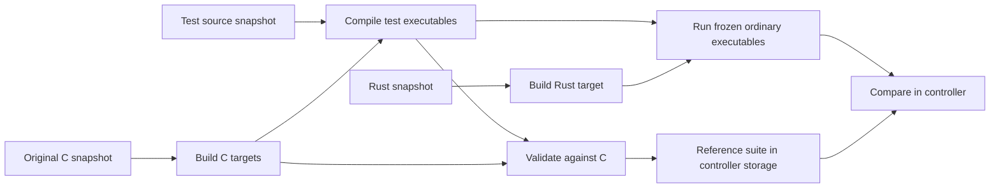

# Generated differential tests for CRISP

Status: historical proposal, superseded by the simpler
[standalone test framework](test-framework.md). The implemented framework uses
the initial Rust translation as its reference and exposes only build/run
operations. The larger C-reference design below is retained for context.

CRISP will accept observation-producing tests written against the original C
interface. It will build and validate those tests against C, retain their
executables and reference observations, and later run the same executables
against the Rust replacement. The controller compares observations outside the
execution sandbox. Generated tests may use files, subprocesses, scripts, and
custom output normalization to exercise the target effectively.

## 1. Contract and scope

For libraries, tests call the non-static functions whose C ABI CRISP preserves.
They use the original declarations and follow the library's object allocation,
initialization, ownership, and destruction conventions. Opaque objects stay
opaque: use the library's creation/destruction functions when that is its
contract. Caller-visible structs may be allocated and inspected as the C API
allows; their exposed layout is then part of the ABI that Rust must preserve.
Callbacks and any explicitly preserved data symbols follow the same contract.

For binaries, tests use arguments, standard input, environment variables, and
other interfaces available to CLI callers. They do not call internal functions
or depend on the Rust implementation. The generator may inspect C implementation
code to understand valid inputs and choose useful observations.

Tests produce meaningful observations on stdout. They may print return values,
buffer contents, callback events, intermediate results between calls, or file
contents. They may sort semantically unordered results, redact unstable values,
and otherwise decide how to represent observations. These decisions become part
of the frozen test source. The controller does no implicit whitespace, numeric,
path, or ordering normalization: it compares stdout as exact bytes.

No framework-specific assertion API or observation schema is required. A test
may still check setup failures and exit unsuccessfully when it cannot execute.
The framework records process exit status independently of stdout. It retains
stderr for diagnosis, and can compare it when explicitly requested. A driver
can also capture target stderr, normalize it, and print it onto its own stdout.

The initial implementation targets Linux ELF executables and shared libraries,
on the same architecture and compatible runtime image for C and Rust. Other
platforms require a loader/runtime adapter. Static linking of the target into
test executables is incompatible with reusing those executables against Rust.
If a static-only C project cannot produce a shared test build, preparation
reports it as unsupported; it must not quietly embed C in the test executable.

## 2. Artifacts and data flow

All artifact names below are proposed. Immutable file contents can use MVIR
`FileNode` and `TreeNode` storage; structured nodes record dependencies and
provenance.

| Artifact | Contents |
| --- | --- |
| `TestSuite` | Versioned manifest, C test sources, scripts, fixtures, and scenario descriptions. No expected observations. |
| `InterfaceSpec` | Original header snapshot, API build defines, preserved symbol inventory, target kind, and logical runtime names. |
| `EnvironmentSpec` | Immutable runtime/toolchain identities, architecture, dependency identities, environment, and runner version. |
| `BuiltTarget` | C or Rust runtime files, profile, dependency metadata, build recipe/source identity, and build logs. |
| `CompiledSuite` | Cached test executables, unchanged scripts/fixtures, runtime metadata, interface identity, profile, and compile logs. |
| `RunBatch` | One actual execution result per selected case and repetition, plus suite/target/environment/policy identities. |
| `ValidationReceipt` | The exact suite, ordinary and sanitizer artifacts, policies, and actual runs that passed validation. |
| `ReferenceSuite` | Accepted suite, ordinary compiled suite, validation receipt, and controller-side C reference results. |
| `ComparisonResult` | Candidate run identities, per-case outcomes, and bounded diagnostics/diffs. |



The ordinary `CompiledSuite` used to record the reference is the one used for
every Rust comparison. It is never rebuilt against Rust headers, relinked to
Rust, or extracted from a translation agent's workspace. Sanitizer executables
are a separate validation variant.

Runtime bundles need metadata for executable modes and library-name symlinks.
Current `TreeNode` storage records bytes and paths, not modes or symlinks. Keep
that metadata in an explicit bundle manifest, install executable permissions
from it, and create validated symlinks during staging. Do not infer executable
permission from file extensions or assume existing checkout preserves it.

## 3. Suite format

Use a small declarative manifest for compilation and execution, with arbitrary
test logic in C programs or scripts. Separate programs from cases so many cases
can share one compiled driver. One suite initially addresses one target
artifact; multiple suites can address different artifacts in a project.

Example library suite:

```toml
schema_version = 1
target = "example"
target_kind = "library"

[[programs]]
name = "objects"
sources = ["src/objects.c", "src/print_helpers.c"]
include_dirs = ["include"]
cflags = ["-std=c11", "-Wall", "-Wextra"]
link_target = true
system_libraries = []

[[cases]]
name = "object_lifecycle"
description = "Create, modify, query, and destroy through the public API."
argv = ["${program:objects}", "lifecycle"]
fixtures = "fixtures/basic"
timeout_seconds = 2
allowed_exit_codes = [0]
compare_stderr = false

[[cases]]
name = "exported_files"
description = "Observe files produced by the public export API."
argv = ["python3", "${suite}/scripts/export_files.py"]
fixtures = "fixtures/export"
```

`${program:objects}` resolves to a staged compiled executable. `${suite}` is
the frozen script/resource tree. The runner also supplies `CRISP_TARGET_EXE`
for binary targets and `CRISP_TARGET_LIB` for explicit dynamic loading. These
names resolve to the same sandbox paths for C and Rust. Scripts can invoke C
helper programs using a runner-provided `CRISP_TEST_BIN_DIR`.

The compiler adds the original interface's include directories and required
API defines automatically. Manifest `include_dirs` add suite-local helper
headers. If a preserved non-static function has no header declaration, supply
an ABI declaration derived from C in the interface snapshot; do not include its
implementation in the test. Declarations must preserve calling convention and
relevant type layout, not just function names.

A CLI suite can contain no C programs at all:

```toml
schema_version = 1
target = "example_cli"
target_kind = "binary"

[[cases]]
name = "parse_input"
argv = ["${target_exe}", "--format=text", "input.dat"]
fixtures = "fixtures/parse_input"
stdin = "fixtures/parse_input/stdin.bin"
allowed_exit_codes = [0]

[[cases]]
name = "invalid_option"
argv = ["${target_exe}", "--invalid-option"]
allowed_exit_codes = [1, 2]
compare_stderr = true
```

`stdin` names a frozen suite file whose bytes the runner supplies; it defaults
to empty input. A fixture directory is copied into a new writable working
directory for each invocation. An optional case environment extends the pinned
environment, subject to reserved runner/loader/sanitizer variables.

Defaults are `allowed_exit_codes = [0]` and `compare_stderr = false`. A direct
CLI case can declare expected nonzero exit codes. The actual exit code must
still match the C reference. A script that explores several error paths can
print each target exit code and finish with zero itself.

Commands are argument arrays, without implicit shell evaluation. A test can
explicitly run `sh` or an interpreter supplied by the runtime image. Manifest
paths must stay within their declared input roots. Reject duplicate names,
missing inputs, invalid placeholders, unsupported dependencies, and attempts
to override framework instrumentation or resource limits. Per-case limits may
lower project limits; only controller configuration can raise them.

## 4. Operations

These are controller-side interfaces, usable without an agent. IDs in the
signatures identify immutable artifacts; each operation produces a structured
result and retains logs even when it fails.

```text
build_target(source, build_spec, environment, profile) -> BuiltTarget
compile_tests(suite, interface, link_inputs, environment, profile) -> CompiledSuite
run_tests(compiled_suite, target, run_policy, selection, repetitions) -> RunBatch
validate_tests(suite, original_c, build_spec, environment, policy) -> ValidationResult
record_reference(compiled_suite, c_target, validation_receipt, policy) -> ReferenceSuite
compare_tests(reference, candidate_target, policy, selection) -> ComparisonResult
prepare_reference(suite, original_c, build_spec, environment, policy) -> ReferenceSuite
```

**Build a target.** Run the configured project build against an immutable source
snapshot, in a build sandbox, and extract only declared runtime products and
dependencies. Use adapters for C and Rust builds, sharing staging metadata.
The C adapter uses the existing artifact's configure/build recipe, with a
profile that can request shared libraries and sanitizer instrumentation. The
Rust adapter extracts the translated binary or shared library. Capture build
configuration and generated public headers in the appropriate artifacts.

**Compile tests.** Compile every declared C program, preserving per-program
success/failure results. Use original headers and declarations, never Rust.
Library drivers link dynamically to the ordinary or instrumented C library;
this requires that library's link inputs, so compilation is independently
callable but may depend on a prior cached C build. An empty program list is
valid for script-only or direct CLI suites. Package scripts and fixtures
without executing them during compilation. Do not accept agent-supplied
precompiled executables as the canonical test binaries.

**Run tests.** Stage the compiled suite and one target in a fresh execution
environment, execute selected cases, and return raw results. This operation
does not need expected observations or decide equivalence. It works equally
for C and Rust. Multiple repetitions always mean distinct actual executions.

**Validate tests.** Rebuild from the submitted source snapshot and pristine C,
perform ordinary repeat runs and sanitizer runs, enforce budgets, and return
case-level diagnostics. No candidate Rust input exists in this operation.
Validation can report successes alongside failures, but does not silently
discard failed cases or publish a partial accepted suite.

**Record a reference.** Require a matching successful validation receipt. Use
the ordinary C results from that validation, or fresh ordinary runs under the
same policy, to record exact reference observations. The receipt binds any
reused runs to the exact binaries, target, fixtures, environment, and policy;
it cannot authorize a different source revision. Expected outputs never come
from model-authored manifest fields. Recording does not rerun sanitizers when
the same accepted receipt already covers them.

**Compare tests.** Use the reference's frozen ordinary executables and scripts
against a candidate target. Compare stdout bytes, normal exit code, and
optionally stderr in the controller. Fail before comparison for crashes,
resource-limit violations, staging/loader errors, or incomplete execution.
Missing or extra results are errors, not ignored pairs. Selection is explicit;
a subset result is marked partial and cannot satisfy a full-suite acceptance
gate. Even if both versions crash, that is not an accepted reference test.

**Prepare a reference.** Convenience operation for the requested "tests + C
code -> outputs" workflow: validate the manifest, build ordinary and sanitizer
C variants, compile test variants, run validation, and record the reference.
It reuses build artifacts and validation runs so this composition does not
unnecessarily rebuild or execute the suite twice.

Comparison against a Rust source snapshot is a further convenience composition:
build the Rust target once, then compare it with one or more reference suites.
It never builds the original C in the candidate execution sandbox.

## 5. Reusing binaries and selecting the implementation

For directly linked library drivers, the interface/staging specification records
the required ELF library names, including `DT_NEEDED`/SONAME names. The runtime
adapter installs the selected implementation under those names in a stable
target directory. A compatibility symlink can map an original SONAME to the
Rust-produced filename; changing a filename does not establish ABI compatibility.

The compiler controls runtime search paths so drivers find that directory.
Avoid absolute C-build paths in `DT_NEEDED`, RPATH, or RUNPATH. Inspect
dependencies with ELF tooling and validate transitive project dependencies.
Set eager dynamic binding where supported so missing exports fail immediately.
Explicit `dlopen` tests use `CRISP_TARGET_LIB` and the same dependency policy.

An execution sandbox contains only:

- Frozen test executables, scripts, and fixtures.
- The chosen target's runtime bundle.
- A pinned runtime image and declared, fixed non-target dependencies.
- Fresh writable working and temporary directories.

A Rust run contains no original target C library/binary, C build tree, or
original source tree. C test driver code remains present in executable form,
as intended. No fallback path may resolve the target to a system-installed C
copy. A missing candidate dependency fails staging or loading. Declared system
libraries such as libc remain available; target-specific libraries must be
accounted for explicitly rather than inherited from a development machine.

The controlled test build rejects original target object files and static
archives as driver link inputs. The staging manifest excludes original target
shared libraries from candidate runs. ELF inspection verifies that directly
linked target symbols remain external to the driver. Source review also
rejects including implementation `.c` files or reproducing the target algorithm
inside the driver; binary/dependency inspection alone cannot establish the
provenance of arbitrary compiled code or prove meaningful target exercise.

CLI drivers receive an executable at the same stable path in C and Rust runs.
They must use that path rather than rebuilding the program or finding a target
through an uncontrolled `PATH` lookup.

## 6. Execution and observations

Build sandboxes and execution sandboxes have different responsibilities. Build
sandboxes receive source and toolchains. Execution sandboxes receive runtime
bundles only. Within an execution sandbox, the suite and target are read-only;
each invocation gets fresh writable working, home, and temporary directories.
Fixtures are restored before every repetition, including file permissions
and pinned timestamps declared in the fixture metadata; default fixture
timestamps are fixed rather than set to staging time. A script can create
further files or start subprocesses freely within the invocation's limits.

Use stable inside-sandbox paths for the suite, target, working directory, and
temporary directory. Set a minimal environment with pinned `PATH`, `HOME`,
`TMPDIR`, locale, timezone, umask, and any declared case settings. Do not inherit
the agent's environment. ASLR need not be disabled: tests should observe pointer
relationships or contents rather than numeric addresses. Do not try to make
wall clocks or OS randomness deterministic globally; use fixed inputs, seeded
test logic, or appropriate normalization when those affect an observation.

Allow subprocesses and local services. External network access is disabled for
execution; isolated loopback remains available. Network tests can start a local
server and report stable behavior rather than ephemeral port numbers. Runtime
tools/interpreters come from the pinned image or declared immutable dependencies.
Tests do not install packages or fetch live fixtures during execution. Fixture
generation and cleanup can be ordinary test code; their time and subprocesses
count toward the case budget.

A trusted supervisor captures stdout and stderr separately as bytes, without a
PTY. It records authoritative exit/signal status, elapsed time, limit violations,
and cleanup status. Generated tests cannot supply their own authoritative
`result.json`. Build logs, shell tracing, supervisor messages, and sanitizer
diagnostics must not be mixed into the stdout observation channel.

One case result contains:

```text
case_id, repetition, compiled_suite_id, target_id, environment_id, policy_id
stdout_blob, stderr_blob
termination = exited(code) | signaled(signal) | limit_exceeded(kind)
elapsed_time, diagnostic_artifacts, cleanup_status
```

Elapsed time, process IDs, and similar metadata are diagnostic and are not
compared. Stdout may contain NULs or invalid UTF-8. Store it losslessly and use
escaped text or a bounded hex diff for display. Exceeding an output cap fails
the case; never truncate an observation and then compare its truncated prefix.

For a script that starts child targets, the script must report relevant child
exit statuses and treat unexpected child crashes as a test failure. The generic
runner can authoritatively check its launched command, but arbitrary scripts
can conceal child failures or ignore results; source review and generation
instructions remain necessary. Normal CLI error exits are valid observations.

The supervisor enforces wall time, CPU, resident-memory/cgroup memory, disk,
output, and process-count limits. Kill and reap the entire invocation's process
tree, including detached children, on completion, timeout, cancellation, or
output overflow. Process-group killing alone is insufficient for children that
create a new session; use a container or dedicated cgroup/process namespace.
Descendants holding output pipes open cannot defeat the timeout. A test that
leaves a background server running is cleaned up before the next invocation.

Enforce a suite deadline in addition to case deadlines, and separate build,
submission-validation, and comparison budgets. Bound parallelism and account
for its aggregate memory/process cost. Start with sequential case execution to
keep timing predictable; concurrency can be introduced without changing tests.

Proposed defaults, all adjustable by controller/project configuration:

| Limit | Initial value |
| --- | --- |
| Ordinary case wall time | 5 seconds |
| Sanitizer case wall time | 15 seconds |
| Full ordinary comparison wall time, including runtime staging | 30 seconds |
| Validation execution/staging wall time | 120 seconds |
| Target or suite build wall time per operation | 300 seconds |
| Normal stdout and stderr | 1 MiB each per invocation |
| Separate sanitizer diagnostic output | 8 MiB per invocation |
| Runtime memory | 1 GiB per invocation |
| Writable files | 128 MiB per invocation |
| Processes | 64 per invocation |
| Ordinary validation repetitions | 3 per case |
| Sanitizer validation repetitions | At least 1 per case |

Builds may need a higher memory budget than execution. ASan reserves substantial
virtual address space: use an actual memory/cgroup limit rather than a small
`RLIMIT_AS` that prevents its runtime from starting. Report ordinary runtimes
and slowest cases so the generator can replace an expensive test with a smaller
case rather than merely requesting a longer timeout.

## 7. Acceptance against C

Validation always receives the controller's immutable original C snapshot.
Agent edits to C, headers, local build products, or previous test binaries do
not affect canonical builds. Snapshot the proposed suite once at submission;
all compilation, repetitions, diagnostics, and acceptance refer to that ID.

The ordinary build supplies reusable executables and reference observations.
The sanitizer build instruments both C test programs and the original C target,
including target code in helper libraries where it is available. Use ASan and
UBSan with recovery disabled, suitable debug information, and frame pointers.
The build adapter must verify that requested flags actually reach compilation
and linking; simply setting `CFLAGS` is insufficient for projects that ignore it.
Record uninstrumented dependencies and unsupported instrumentation explicitly.
An unsupported or failed sanitizer setup is not a clean sanitizer result.

Capture sanitizer reports independently of any driver output normalization,
using supervised per-process diagnostic logs or a dedicated collector. Child
target processes must inherit the framework's instrumentation settings. Tests
must not suppress reports or override reserved sanitizer settings. Account for
diagnostic limits and inspect reports even when the top-level driver exits zero.
Sanitizer diagnostics are validation failures and diagnostic artifacts, never
reference observations. Ordinary binaries, not instrumented binaries, are
reused for the ordinary Rust comparison; this design does not claim that C
sanitizers instrument arbitrary Rust code.

For each case, validation requires all of the following:

1. Its canonical build and runtime staging succeed.
2. Every required execution finishes normally within the configured budget and
   returns an allowed exit code.
3. Ordinary repetitions agree exactly on stdout, exit code, and stderr when
   that case requests stderr comparison.
4. Sanitizer runs complete with no reported violations or collector errors.
5. The entire suite fits the ordinary comparison budget, measured with an
   actual complete ordinary pass including staging, and stays within validation
   budgets. An individually fast suite can still be too large overall.

Repeat runs are fresh executions with fresh fixtures and no cached run results.
Raw stderr may vary when it is diagnostic only. Sanitizer output is checked for
violations rather than compared byte for byte with ordinary output. Passing
finite repetitions establishes observed stability, not proof of determinism.
Do not automatically accept flaky cases using retries, majority voting, or a
union of observed outputs. Return the differing runs to the generator to fix.

The framework does not attempt to infer and enforce every API precondition.
Generation instructions require valid calls: correct pointer/length pairs,
required initialization, object lifetimes, allocator/deallocator pairing,
permitted aliasing, and documented null/error-input behavior. Null is a useful
error test only where the API defines it; it is not a generic edge case for all
pointer arguments. The generator should explain unusual boundary inputs in
test comments. A future review or static analysis can supplement sanitizers.

Sanitizers cannot prove that a test has no UB. A detected issue may be in the
driver or the original implementation. Keep the failing case and diagnostic
with that distinction unresolved if necessary; it cannot enter the accepted
reference suite until resolved. Never alter C solely to obtain a clean oracle,
or require Rust to reproduce an undefined C result.

Reject an empty suite and report cases that produce no stdout so the generator
can justify or improve them. Empty stdout may still be useful with a deliberate
exit-status observation. Ask the generator for the APIs and scenarios exercised
and explicit omissions. This inventory is a coverage aid, not trusted proof of
execution. Coverage instrumentation can be added later without changing the
observation contract.

## 8. Cache keys and storage

Cache compilation and immutable target builds. Publish completed successful
artifacts atomically; cancellation or partial failure must not leave something
that looks reusable. Individual successful programs may be reused after another
program fails, but a compiled suite is complete only when all its programs build.

| Cached item | Key inputs |
| --- | --- |
| C/Rust target build | Source tree, complete build recipe/configuration, generated-input identities, target artifact, toolchain/image identities, profile, dependency identities, build-adapter version. |
| C test program | All source/helper/header bytes and generated inputs, effective compiler/linker arguments, original interface, link inputs, toolchain/image identities, architecture, profile, compiler-adapter version. |
| Compiled suite | Manifest, program artifact IDs, scripts, fixtures, and runtime bundle metadata. |
| Accepted reference | Suite and compiled-suite IDs, original C target ID, environment, validation/comparison policies, validation receipt, and selected actual ordinary C results. |

For an initial conservative implementation, include the C link artifact's full
identity in the test program key. Reusing executables across C implementation
changes using only an ABI fingerprint is a possible later optimization. A
translation change does not invalidate test executables or C reference outputs;
it invalidates the candidate target build.

Image tags and compiler path strings are not sufficient identities. Record an
immutable image digest and compiler/runtime/dependency fingerprints; for local
toolchains, materialize an explicit fingerprint or use a pinned environment.
Build recipes must not fetch unpinned dependencies or use undeclared host inputs
if their results are to be cached. Include case environment and resource
policies in run/reference provenance, even when they do not affect compilation.

Keep raw `RunBatch` executions uncached by default. In particular, do not place
the repeated-execution primitive behind the existing `@analysis` cache. Build
results and an already accepted immutable reference may be reused, but an
explicit revalidation request performs new validation executions. Do not reuse
old comparison passes under a new suite, reference, environment, or policy.

Current `@analysis` ignores `Config` and `Sandbox` arguments. New cacheable
operations must therefore receive explicit IDs for the relevant configuration,
environment, policies, and runner/build-adapter versions, and store those IDs
on result nodes. Changing a setting must not accidentally reuse stale results.

## 9. Controller boundary and generator submission

Reference observations and their MVIR storage remain outside every execution
sandbox. They are not mounted read-only, copied beside binaries, embedded into
the manifest, or passed in environment variables. The controller captures
candidate observations and loads the expected observations only to compare
them. A failed Rust comparison never updates the reference.

The generator uses the existing agent invocation and authenticated callback
mechanism. It receives original C, original headers/documentation, the suite
format, configured dependencies, budgets, and the preserved-interface contract.
It receives no Rust source. Canonical submission runs take place in fresh
build/execution sandboxes rather than in the generator's sandbox.

Provide a helper with a submission interface such as:

```sh
crisp_submit_tests.sh generated-tests/suite.toml
```

The helper requests submission through `POST /crisp/submit_tests`. The controller
validates the manifest path under the configured generated-test root, snapshots
that root into an immutable suite, and starts preparation/validation against
the controller's original C snapshot. The request cannot select arbitrary host
paths, change the original C identity, or raise budgets. Validate the manifest
before expensive work.

Return a submission ID promptly. A status endpoint and helper polling provide
progress for long builds without holding an asynchronous HTTP handler open.
The final response includes acceptance status, exact suite/reference IDs,
per-case build/runtime results, stability diffs, sanitizer reports, time-budget
failures, and ordinary runtimes. Serialize workflow/MVIR mutations through the
controller rather than assuming arbitrary concurrent writes are safe.

The generator may revise and resubmit. Failed cases do not disappear silently;
it must fix them or explicitly remove them in a new source revision. Record
acceptance by immutable submission ID. At generation completion, select an
accepted submission explicitly, and ensure that the agent's final intended
suite matches it. Do not use "last files left in the sandbox" as an accepted
suite, since those files may have changed after validation. If no submission
passes, generation is unsuccessful rather than a passing empty test suite.

A candidate test runtime receives neither agent API credentials nor callback
tokens or host access to the controller. Its network/filesystem policy must
also prevent access to the reference store. Feedback shown to the generator
or rewriter is bounded diagnostic information, not a mounted expected-output
artifact. This boundary prevents reading or overwriting the reference during
execution; it cannot prove that arbitrary generated code makes a meaningful
call instead of printing a constant. Review, scenario inventories, and later
coverage/mutation checks address that separate quality concern.

## 10. CRISP integration

Use `agent.run_agent_for_workflow` with only C-side inputs and a test-directory
output filter. Install the submission callback alongside the existing planning
and test callbacks. The generic framework remains callable from the CLI or
Python without invoking an agent.

Store the accepted `ReferenceSuite` ID in workflow/branch state, independently
of both original C and translated code. Preserve it when resuming a safety loop
or branching from a translation. Integrate generation before the initial
transpile so the first Rust output and all later refactoring steps use the same
frozen suite. A standalone preparation command supports projects whose Rust
translation has not started yet.

Extend the host-side `Workflow.test_op` gate to run configured legacy tests and
generated-suite comparisons. Both must succeed when both are enabled. The
existing `crisp_run_tests.sh` callback uses the branch's frozen reference suite;
edits to test files in the rewriter sandbox do not replace its executable suite.
The comparison must stay controller-side, rather than putting expected output
into a new sandbox `test_command`.

Keep "generation disabled", "no reference prepared", "validation failed", and
"generated tests passed" distinct. The current fallback to a `true` test command
cannot stand in for a generated-suite pass. Existing tests and generated
tests can coexist; a configured test command may only build code and does not
establish that useful behavioral tests already exist.

The current `Sandbox.run` API merges stdout/stderr and does not expose all
required limits, cleanup, environment scrubbing, or minimal runtime staging.
Introduce a purpose-specific execution API, for example
`run_test_process(bundle, invocation, policy) -> ProcessResult`, rather than
implementing observation capture through `sh -x` or parsing build logs.

Sandbox backends must advertise support for separate byte streams, enforced
limits/cancellation, descendant cleanup, immutable bundles, fresh state,
minimal environment, isolated loopback, and exclusion of host/reference files.
The current development bwrap backend exposes most of the host root read-only
and shares networking; the current agent paths can inject credentials. They
need a dedicated runtime mode to satisfy this design. A backend lacking a
required capability reports unsupported rather than silently weakening the
reference-isolation or execution contract. Reuse sandbox lifecycle and artifact
transport code where possible, with runtime-specific policy.

Implementation can be split into a `crisp/testing/` package for suite parsing,
artifact models, build adapters, execution, validation, and comparison; small
workflow methods compose these operations. Add MVIR node kinds for their
structured results rather than encoding all provenance in shell strings.

## 11. Results, diagnostics, and implementation checks

Distinguish manifest errors, unsupported configurations, target build failures,
test compile failures, staging/ABI failures, sanitizer violations,
nondeterminism, time/resource limits, observation mismatches, cancellation, and
infrastructure errors. A comparison reports an ordinary mismatch only after
successful execution. No class of failure becomes a pass because a result was
missing, a subprocess timed out, or the output was empty.

Keep full bounded raw artifacts in MVIR and return concise summaries to the
agent: test name, phase, status, runtime, and first useful diagnostic or output
difference. A global timeout marks unstarted cases as not run; it never passes
the already executed prefix. Fail-fast comparison may stop after a failing
case, but its result is still a failed/incomplete full-suite check.

Meaningful end-to-end implementation checks should include:

- A C library and ABI-compatible Rust replacement run with identical driver
  bytes; a deliberately changed Rust return value produces a host-side diff.
- A missing Rust export or dependency fails; a C library available in a build
  sandbox or on the development host cannot satisfy the candidate load.
- CLI stdin, nonzero normal exits, stderr observations, file I/O, script-driven
  normalization, and subprocesses work with the same frozen suite.
- A nondeterministic C test and sanitizer violations in both driver and target
  are rejected; repeated validation actually executes each repetition.
- Timeouts, stdout/stderr overflow, detached descendants, cancellation, and
  retained pipe handles terminate cleanly and cannot hang the controller.
- Cached binaries preserve modes; fixture state resets; binary stdout survives
  capture unchanged; reference files and callback credentials are unavailable
  to tests.
- Header/flag/toolchain/policy changes invalidate the relevant artifacts;
  changing only Rust reuses the ordinary test binaries and reference.
- Edits after a successful submission cannot alter its reference suite;
  missing cases, partial selections, and an empty suite cannot pass a full gate.

Build the runner and these operations before connecting generation. A hand-made
library suite and CLI suite can establish substitution, reference isolation,
capture, and resource enforcement without involving a model. Then add the
submission callback and generation workflow on top of that tested interface.
